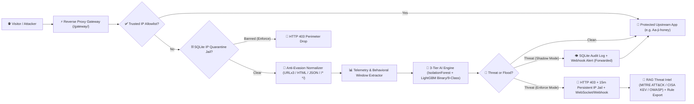

# 🛡️ SentinelAI: Autonomous 24/7 Reverse-Proxy WAF, AI Intrusion Engine & SOC Platform

SentinelAI is a full-stack **24/7 Web Application Firewall (WAF), Reverse-Proxy Shield, and Autonomous SOC Platform**. It combines an inline HTTP/HTTPS reverse-proxy gatekeeper, recursive anti-evasion OWASP inspection, a 3-Tier ML intrusion detection cascade trained on **20.4M network flows** (**CIC-IDS2017**, **CSE-CIC-IDS2018**, **UNSW-NB15**), **TreeSHAP explainability**, a pure-Python **PCAP flow reconstructor**, and a **3,774-vector ChromaDB RAG agent** for automated MITRE ATT&CK / OWASP incident response.

---

## 🏗️ End-to-End Defense Architecture



---

## ✨ Key Production Capabilities

* **24/7 Inline Reverse Proxy & SPA Asset Rewriting (`/gateway/`)**:
  Transparently sits in front of live production targets (tested protecting `https://aai-ji-honey.vercel.app`), rewrites root-relative SPA assets for seamless proxying, strips sensitive server leak headers (`x-powered-by`), and stamps `x-protected-by: SentinelAI-Autonomous-SOC-Shield`.
* **Anti-Evasion Multi-Stage WAF Normalization (`backend/app/proxy/flow_tracker.py`)**:
  Applies up to 3 recursive URL-decoding passes, HTML entity unescaping, null-byte removal, SQL inline comment collapsing (`/**/` -> space), and nested JSON body extraction before inspecting for SQLi, XSS, Log4Shell (`${jndi:...}`), XXE, path traversal (`%252e%252e%252f`), `.env`/`.git` secret probes, RCE, SSRF parameters, directory busting, and scanner user-agents (`sqlmap`, `nikto`, etc.).
* **Persistent Active Defense & Allowlisting (`backend/app/db/traffic_store.py`)**:
  WAL-mode SQLite persistence with synchronized in-memory read-through caches ensures quarantined attacker IPs, allowlisted operator IPs, shield configurations, and time-series traffic telemetry survive server restarts.
* **Shadow (Audit) vs. Enforce Mode**:
  Operators can switch live between `shadow` (audit & alert silently without blocking visitors) and `enforce` (active HTTP 403 interception + 15-minute IP jail).
* **Security Hardened Operations (`backend/app/core/security.py`)**:
  * **SSRF Guard** preventing admin target/webhook URLs from pointing to `localhost`, RFC1918 subnets, `169.254.169.254` cloud metadata, or non-HTTP schemes.
  * **Operator Authentication** (`X-Sentinel-Token` / `Bearer` via constant-time `hmac.compare_digest` when `SENTINEL_ADMIN_TOKEN` is configured; remote admin access blocked unless configured).
  * **XSS-Safe SOC Dashboard** strictly escaping all untrusted HTTP paths, IPs, and reasons before DOM rendering.
* **RAG Incident Triage, Webhook Alerts & Edge Rule Export**:
  * One-click MITRE ATT&CK / OWASP incident correlation and **Markdown brief download** directly from any blocked traffic row.
  * Non-blocking **Discord / Slack / HTTP webhook** alerts with per-IP cooldown anti-spam.
  * Ready-to-deploy **Nginx `deny`**, **`iptables`**, and **Cloudflare WAF** rule exports from active quarantine bans.
* **Zero-Driver Pure-Python PCAP Inspector (`network/flow_extraction/pcap_parser.py`)**:
  Upload classic `.pcap` captures via `POST /api/predict/pcap` or the UI to reconstruct bidirectional 5-tuple TCP/UDP flows into 18 `FlowData` features and run 3-tier ML classification.

---

## 📊 Verified Empirical Benchmarks

### 1. Inline Reverse-Proxy & Evasion Benchmark ([`backend/tests/benchmark_shield.py`](backend/tests/benchmark_shield.py))
Measured end-to-end across single-process FastAPI ASGI with persistent SQLite WAL logging and compiled Tier-1/Tier-2 ML scoring:

| Metric | Observed Result |
| :--- | :--- |
| **Clean Requests Evaluated** | `100` |
| **Clean False Positives** | `0 / 100` (**`0.00%`**) |
| **Inline Latency (Mean / P50 / P95)** | **`17.04 ms`** / **`17.01 ms`** / **`18.58 ms`** *(reduced >5× from 95.03 ms baseline via compiled IsolationForest traversal & SQLite caching)* |
| **Evasion Vectors Blocked** | `11 / 11` (**`100.0%`**) *(inline-comment SQLi, JSON SQLi, double-encoded traversal, HTML-entity XSS, Log4Shell, RCE, `.env`/`.git`, SSRF param, `nikto`)* |
| **Automated Security & Proxy Test Suite** | **`13 / 13` passing** (`python -m unittest discover -s tests -v`) |

### 2. Core 3-Tier ML Benchmark (20.4M Unified Flows)
Evaluated across `2,043,282` held-out test flows (CSE-CIC-IDS2018, CIC-IDS2017, UNSW-NB15):
* **ROC-AUC**: `0.99183` | **PR-AUC**: `0.98340` | **F1 Score**: `0.97296` | **Global FPR**: `0.0576%`
* **Batch Throughput**: `654,327 flows/sec` (`Tier 2 LightGBM`: `0.41 ms` single-flow inference, bitwise-verified compiled `Tier 1 IsolationForest`: `2.66 ms` single-flow)

---

## 🚀 Quickstart

### Option 1: Docker Compose (Recommended for 24/7 Cloud Hosting)

```bash
cp .env.example .env
# Set a strong SENTINEL_ADMIN_TOKEN inside .env before exposing publicly
docker compose up -d --build
```

The SOC Dashboard & Reverse Proxy Gateway will be available at `http://localhost:8000/` and healthchecked at `/api/health`.

### Option 2: Local Python Environment

```bash
pip install -r backend/requirements.txt
uvicorn backend.app.main:app --host 0.0.0.0 --port 8000
```

Open **`http://127.0.0.1:8000/`** and switch to the **🌐 24/7 Website Shield** tab.

### Running Tests & Benchmarks

```bash
python -m unittest discover -s tests -v
python backend/tests/benchmark_shield.py
```

---

## 🛠️ Repository Layout

* **`backend/`**: FastAPI server, core security guards (`core/security.py`), reverse proxy (`proxy/gateway.py`, `proxy/flow_tracker.py`), persistent SQLite store (`db/traffic_store.py`), 3-tier ML service (`services/inference_engine.py`), webhook dispatcher (`services/alert_notifier.py`), and REST/WebSocket APIs.
* **`network/`**: Zero-driver pure-Python `.pcap` 5-tuple flow extractor (`flow_extraction/pcap_parser.py`).
* **`intelligence/`**: ChromaDB threat-intel RAG ingestion/retrieval (`rag/`), multi-provider reasoning engine (Deterministic / Ollama / Gemini / OpenAI), and Markdown incident report generator.
* **`ml/`**: Feature engineering, 20.4M training pipelines, saved production models (`ml/saved_models/production/`), evaluation, and `TreeSHAP` explainability.
* **`frontend/`**: Dark cyber SOC dashboard UI with XSS-safe rendering, real-time traffic chart, IP quarantine/allowlist controls, rule export, and `.pcap` analyzer.
* **`tests/`**: Isolated `TestClient` integration tests covering anti-evasion WAF rules, SSRF guards, operator auth, persistent quarantine, PCAP extraction, and RAG brief generation.
* **`docs/`**: Complete Stage 1–9 engineering reports ([`docs/README.md`](docs/README.md), [`docs/CHANGELOG.md`](docs/CHANGELOG.md)).
