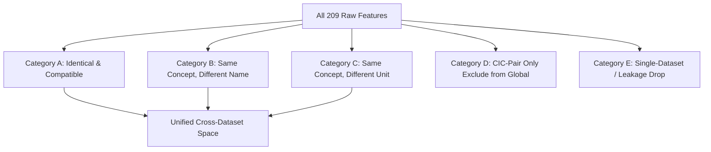

# SentinelAI: Cross-Dataset Inspection & Merging Strategy Report

**Stage**: 03 - Inter-Dataset Inspection  
**Notebook**: [ml/notebooks/04_Inter_dataset_inspection.ipynb](../../../ml/notebooks/04_Inter_dataset_inspection.ipynb)  
**Datasets Analyzed**: 
- **CIC-IDS2017** (`2,830,743` flows, 80 features)
- **CSE-CIC-IDS2018** (`16,232,943` flows, 80 features)
- **UNSW-NB15** (`1,369,133` flows, 49 features)  
**Combined Traffic Volume**: **20,432,819 flows** across 209 raw feature columns

---

## 1. Executive Summary & Core Objective

The goal of this inspection is to merge three benchmark intrusion detection datasets without introducing **data leakage**, **scale distortions**, or **tool-specific artifacts**. 

A naive merge based solely on literal column names yields only **1 matching feature** (`Label`). However, through rigorous domain semantic mapping, we have identified **16–20 core physical network flow features** that exist across all three datasets and can be mathematically aligned into a single, highly generalizable feature space.

---

## 2. The 5-Category Feature Merging Strategy

Every candidate feature across the 209 total columns has been classified into one of five rigorous operational buckets:

### Category A — Common and Compatible (Use Directly)
*Features that share identical names, identical units, and identical semantics across all datasets.*
* **`target_label`**: Standardized to `int8` ($0 = \text{Benign/Normal}, 1 = \text{Attack}$).
* **`dst_port`**: Integer destination port ($0–65535$). (Native column: `Destination Port` in 2017, `Dst Port` in 2018, `dsport` in NB15).

---

### Category B — Same Concept, Different Name (Map to Canonical Name)
*Features measuring the exact same physical flow metric with the same units, differing only by naming conventions.*

| Canonical Name | CIC-IDS2017 Column | CSE-CIC-IDS2018 Column | UNSW-NB15 Column | Native Unit | Action |
| :--- | :--- | :--- | :--- | :--- | :--- |
| `fwd_packets` | `Total Fwd Packets` | `Tot Fwd Pkts` | `Spkts` | Packet count | Rename to `fwd_packets` |
| `bwd_packets` | `Total Backward Packets` | `Tot Bwd Pkts` | `Dpkts` | Packet count | Rename to `bwd_packets` |
| `fwd_bytes` | `Total Length of Fwd Packets` | `TotLen Fwd Pkts` | `sbytes` | Bytes | Rename to `fwd_bytes` |
| `bwd_bytes` | `Total Length of Bwd Packets` | `TotLen Bwd Pkts` | `dbytes` | Bytes | Rename to `bwd_bytes` |
| `fwd_pkt_len_mean` | `Fwd Packet Length Mean` | `Fwd Pkt Len Mean` | `smeansz` | Bytes/pkt | Rename to `fwd_pkt_len_mean` |
| `bwd_pkt_len_mean` | `Bwd Packet Length Mean` | `Bwd Pkt Len Mean` | `dmeansz` | Bytes/pkt | Rename to `bwd_pkt_len_mean` |

---

### Category C — Same Concept, Different Unit / Scale (Map + Mathematical Conversion)
*Features that represent the same physical property, but were measured on different scales or require derivation.*

| Canonical Name | CIC-IDS Native Unit | UNSW-NB15 Native Unit | Standard Unit | Mathematical Transformation |
| :--- | :--- | :--- | :--- | :--- |
| `flow_duration` | $\mu s$ (Microseconds) | $s$ (Seconds) | **Seconds ($s$)** | **CIC**: `x / 1e6` **NB15**: `x` (none) |
| `fwd_iat_mean` | $\mu s$ (Microseconds) | $ms$ (Milliseconds) | **Seconds ($s$)** | **CIC**: `x / 1e6` **NB15**: `x / 1e3` |
| `bwd_iat_mean` | $\mu s$ (Microseconds) | $ms$ (Milliseconds) | **Seconds ($s$)** | **CIC**: `x / 1e6` **NB15**: `x / 1e3` |
| `flow_iat_mean` | $\mu s$ (Microseconds) | $s$ (Seconds, `tcprtt`) | **Seconds ($s$)** | **CIC**: `x / 1e6` **NB15**: `x` (none) |
| `flow_bytes_s` | Bytes/sec | Bits/sec (forward only, `Sload`) | **Bytes/sec** | **CIC**: `x` **NB15**: `(sbytes + dbytes) / np.maximum(dur, 1e-6)` |
| `flow_pkts_s` | Packets/sec | Non-existent in raw NB15 | **Packets/sec** | **CIC**: `x` **NB15**: `(Spkts + Dpkts) / np.maximum(dur, 1e-6)` |
| `fwd_tcp_win` | 16-bit bytes ($0–65535$, $-1$) | 8-bit index ($0–255$) | **Ratio $[0, 1]$** | **CIC**: `np.maximum(x, 0) / 65535.0` **NB15**: `x / 255.0` |
| `bwd_tcp_win` | 16-bit bytes ($0–65535$, $-1$) | 8-bit index ($0–255$) | **Ratio $[0, 1]$** | **CIC**: `np.maximum(x, 0) / 65535.0` **NB15**: `x / 255.0` |

---

### Category D — Pair-Only Features (CIC-IDS2017 ∩ CSE-CIC-IDS2018)
*Features present across both Canadian Institute for Cybersecurity benchmarks, but absent in UNSW-NB15.*
* **Individual TCP Flags**: `SYN Flag Count`, `ACK Flag Count`, `FIN Flag Count`, `RST Flag Count`, `PSH Flag Count`, `URG Flag Count`.
* **Statistical Moments**: `Fwd/Bwd Packet Length Std`, `Packet Length Variance`, `Flow IAT Std`.
* **Active/Idle Windows**: `Active Mean`, `Active Std`, `Idle Mean`, `Idle Std`.
* **Subflow Metrics**: `Subflow Fwd Packets`, `Subflow Fwd Bytes`.

> [!TIP]
> **Strategy for Category D**: Exclude from the **Global 3-Dataset Unified Core**. You can optionally train a specialized **CIC-only high-resolution model** with these features to compare against the unified baseline.

---

### Category E — Dataset-Specific & Data Leakage Features (Drop Completely)
*Features unique to a single capture environment or carrying dangerous artifacts.*

1. **Severe Data Leakage (Must be Dropped)**:
   * `srcip`, `dstip`: Forces models to memorize specific IP subnets rather than attack behavior.
   * `sport`: Ephemeral client ports ($49152–65535$) introduce high-cardinality random noise.
   * `Stime`, `Ltime`, `Timestamp`: Absolute Unix timestamps cause temporal overfitting.
   * `stcpb`, `dtcpb`: Arbitrary random 32-bit TCP base sequence numbers.
2. **Tool-Specific Bro/Zeek Windows (UNSW Only)**:
   * `ct_srv_src`, `ct_srv_dst`, `ct_dst_ltm`, `ct_src_ltm`, etc.: Cross-flow 100-connection rolling windows that do not exist in standard flow collectors like NetFlow or CICFlowMeter.
3. **Application Layer DPI (UNSW Only)**:
   * `ct_flw_http_mthd`, `is_ftp_login`, `trans_depth`, `res_bdy_len`: Absent in CIC and unusable on encrypted TLS traffic.

---

## 3. Top 8 Pre-Training Traps & Key Observations

### Trap 1: The $10^6\times$ Time Scale Mismatch
* CICFlowMeter outputs duration and IATs in **microseconds** ($\mu s$).
* UNSW-NB15 outputs duration in **seconds** ($s$) and IATs in **milliseconds** ($ms$).
* *Consequence if missed*: A 1-second flow in CIC would be evaluated as $1,000,000$ vs $1.0$ in NB15, completely confusing tree splits and neural network gradients.

### Trap 2: The Flow Timeout Hard Cap
* CICFlowMeter enforces a hard maximum flow timeout of **120 seconds** ($120,000,000\mu s$).
* Argus/Zeek (UNSW-NB15) enforces a hard timeout of **60 seconds**.
* *Action*: Clip duration at 60 seconds (`np.minimum(dur, 60.0)`) or apply log-scaling (`np.log1p(dur)`).

### Trap 3: The String-Casing Label Trap
* CIC-IDS2017 uses uppercase `'BENIGN'`.
* CSE-CIC-IDS2018 uses title case `'Benign'`.
* UNSW-NB15 uses integers `0` and `1`.
* *Action*: Always use `.astype(str).str.strip().str.upper() != 'BENIGN'` to generate binary labels.

### Trap 4: The 2018 Typographical Error
* In CSE-CIC-IDS2018, Infiltration attacks are misspelled as **`'Infilteration'`**.
* *Action*: Explicitly map both `'Infiltration'` and `'Infilteration'` to the same canonical class.

### Trap 5: Heavy-Tailed Skewness ($> 20$)
* In all three datasets, features like `fwd_bytes`, `flow_bytes_per_sec`, and `fwd_packets` have extreme right-skewness ($20–45$).
* The 50th percentile (median) forward packet count is $3$, while the maximum is $> 5,000$.
* *Action*: **Standard Z-score scaling will fail**. Use **`np.log1p(x)`** or **`RobustScaler`** (median and IQR) before feeding features into machine learning models.

### Trap 6: Multi-Class Extreme Imbalance
* `Normal`: $17,060,373$ flows.
* `DDoS` + `DoS`: $2,304,637$ flows.
* `Worms`: only **62 flows** in the entire 20.4-million dataset.
* *Action*: For multi-class prediction, use **Coarse Macro-Taxonomy (8 families)** rather than granular 14 families to avoid single-batch zero-representation.

### Trap 7: The TCP Window Scale Gap
* CIC uses raw 16-bit window sizes (up to $65,535$), with $-1$ representing non-TCP.
* NB15 stores an 8-bit scale index (up to $255$).
* *Action*: Normalize both to a dimensionless $[0, 1]$ ratio: `np.maximum(x, 0) / 65535.0` and `x / 255.0`.

### Trap 8: Division-by-Zero in Derived Rates
* In zero-duration flows (flows consisting of only 1 or 2 instant packets where $t_{last} - t_{first} = 0$), computing $\text{Bytes} / \text{Duration}$ produces infinite values (`np.inf`).
* *Action*: Always clamp duration with an epsilon floor: `np.maximum(dur, 1e-6)`.

---

## 4. The Unified Feature Blueprint

The merged training dataset will contain **16 core behavioral features** + **2 labels**:

| Index | Unified Feature Name | Type | Scaling / Preprocessing Recommendation |
| :---: | :--- | :---: | :--- |
| 1 | `dst_port` | `int32` | Frequency encoding or categorical embedding |
| 2 | `flow_duration_s` | `float32` | `np.log1p` |
| 3 | `fwd_packets` | `int32` | `np.log1p` |
| 4 | `bwd_packets` | `int32` | `np.log1p` |
| 5 | `fwd_bytes` | `float32` | `np.log1p` |
| 6 | `bwd_bytes` | `float32` | `np.log1p` |
| 7 | `fwd_pkt_len_mean` | `float32` | `RobustScaler` |
| 8 | `bwd_pkt_len_mean` | `float32` | `RobustScaler` |
| 9 | `flow_bytes_per_sec` | `float32` | `np.log1p` |
| 10 | `flow_pkts_per_sec` | `float32` | `np.log1p` |
| 11 | `flow_iat_mean_s` | `float32` | `np.log1p` |
| 12 | `fwd_iat_mean_s` | `float32` | `np.log1p` |
| 13 | `bwd_iat_mean_s` | `float32` | `np.log1p` |
| 14 | `fwd_tcp_win_ratio` | `float32` | Range $[0, 1]$ |
| 15 | `bwd_tcp_win_ratio` | `float32` | Range $[0, 1]$ |
| 16 | `traffic_symmetry_ratio` | `float32` | Derived: `fwd_bytes / (fwd_bytes + bwd_bytes + 1e-6)` |
| — | **`binary_label`** | `int8` | $0 = \text{Benign}, 1 = \text{Attack}$ |
| — | **`attack_family`** | `string / category` | 8 Macro-Families |

---

## 5. Next Steps & Pipeline Implementation Plan

1. **Step 1: Save the Merging Manifest**
   Export the formal mapping specification JSON/Dictionary from Notebook 4 so preprocessing pipelines can ingest it programmatically.
2. **Step 2: Stream-Processing Pipeline (Notebook 5 / ETL Script)**
   Because CSE-CIC-IDS2018 alone is $16.2\text{M}$ rows, do **not** load everything into memory simultaneously. Process each interim parquet file in chunks, apply the Category A, B, C transformations, and stream to `ml/data/processed/merged_sentinel_core.parquet`.
3. **Step 3: Train-Validation-Test Splitting Strategy**
   * *Critical Rule*: **Never perform a naive random split across all 20M rows.** Random shuffling leaks time correlations.
   * Split by **dataset capture session / day** or evaluate cross-dataset generalization (e.g., train on 2017 + 2018, test on NB15).
